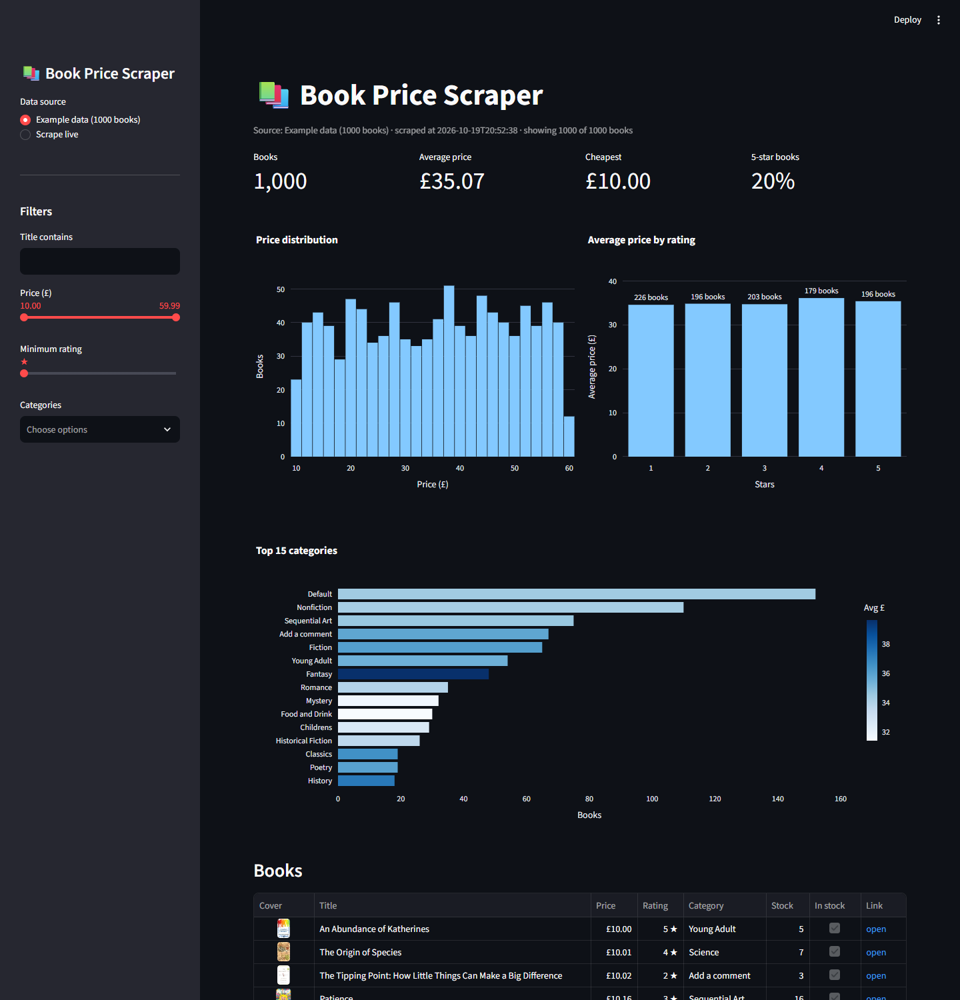
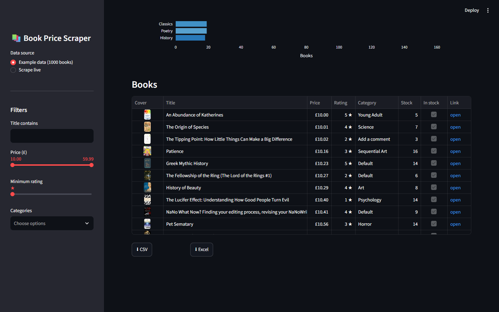
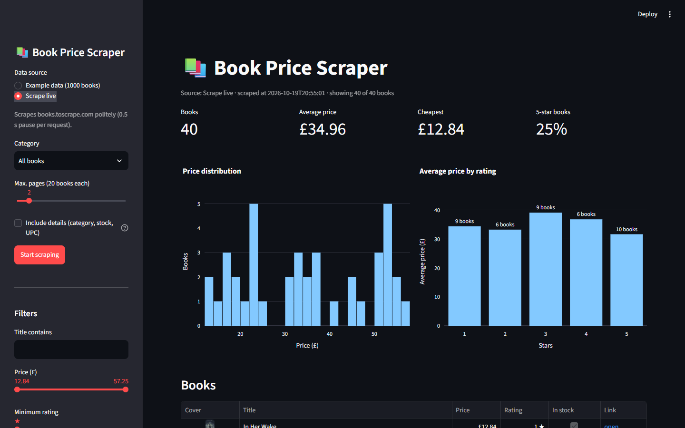
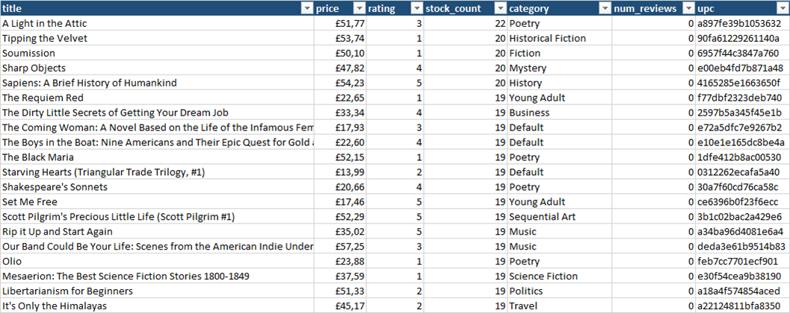

# 📚 Book Price Scraper

A polite, tested Python web scraper that collects **titles, prices, ratings, stock levels
and categories** from an online book shop across all pages, cleans the data and exports it
to **CSV, Excel, JSON or SQLite**. Comes with a command line tool and a Streamlit dashboard.

It scrapes [books.toscrape.com](https://books.toscrape.com), a sandbox shop built for
practising web scraping. The same structure works for real shops, marketplaces, job boards or
directories: only one file (`parser.py`) knows what the website looks like.



## The problem

Copying product data from a website by hand is slow and error-prone: hundreds of pages,
prices as text with currency symbols, ratings hidden in CSS classes, stock numbers buried in
sentences. Quick scripts break on the first timeout or get blocked for sending too many
requests.

This project shows how to do it properly: follow the pagination automatically, retry
temporary errors, respect the site's rules, and deliver clean, typed data in the format the
client actually wants.

## Features

- **Pagination**: follows the "next" link until the last page or a `--pages` limit
- **Detail pages** (optional): category, UPC, exact stock count, number of reviews, description
- **Category filter**: scrape a single category by name (`--category Travel`)
- **Data cleaning**: `£51.77` → `51.77`, `"Three"` → `3`, `"In stock (22 available)"` → `22`,
  duplicates removed, timestamp added for price tracking
- **Filters**: max. price, min. rating, in stock only
- **Export** to CSV (Excel-friendly UTF-8), formatted Excel (frozen header, filters, £ format),
  JSON, or SQLite (replace or `--append` to build a price history)
- **Polite by default**
  - checks `robots.txt` before every request
  - 1 second delay between requests (configurable)
  - automatic retries with exponential backoff for timeouts, 429 and 5xx errors
  - honest User-Agent
- **Robust**: a failing page never crashes the run, the books collected so far are kept
- **Logging** to the console and to `output/scraper.log`
- **Encoding fix**: the site sends no charset header, so `requests` would turn `£` into `£`.
  The scraper detects the real encoding.
- **Streamlit dashboard**: KPIs, price distribution, price by rating, top categories, a table
  with cover images and links, CSV/Excel download, and a live scrape button
- **60 automated tests** (pytest) that run on saved HTML files, **no internet needed**

## Screenshots

| Book table with covers and filters | Live scraping from the browser |
|---|---|
|  |  |

The formatted Excel export:



## Installation

Requires Python 3.10 or newer.

```bash
git clone https://github.com/Sossa300/book-price-scraper.git
cd book-price-scraper
python -m venv .venv
.venv\Scripts\activate        # Windows  (macOS/Linux: source .venv/bin/activate)
pip install -r requirements.txt
```

## Usage

### Command line

```bash
python main.py --pages 3                                   # first 3 pages -> output/books.csv
python main.py --format csv xlsx json sqlite               # whole catalogue, all formats
python main.py --category Travel --details --format xlsx   # one category with detail pages
python main.py --max-price 20 --min-rating 4 --in-stock    # only cheap, well-rated books
python main.py --format sqlite --append                    # run daily to track prices
python main.py --list-categories                           # show all 50 categories
python main.py --help                                      # all options
```

Example output:

```
INFO    No robots.txt at https://books.toscrape.com (HTTP 404), everything allowed
INFO    Page 1: 20 books (https://books.toscrape.com/catalogue/page-1.html)
INFO    Page 2: 20 books (https://books.toscrape.com/catalogue/page-2.html)
INFO    Finished: 40 books from 2 page(s)
INFO    Saved 40 books to output\books.csv
INFO    Saved 40 books to output\books.xlsx
INFO    Average price: GBP 34.96 | cheapest: GBP 12.84 | most expensive: GBP 57.25
```

| Option | Default | Meaning |
|---|---|---|
| `--pages N` | all | maximum number of listing pages (20 books each) |
| `--category NAME` | – | only one category (case-insensitive) |
| `--details` | off | open every book page for more fields (1 extra request per book) |
| `--max-price`, `--min-rating`, `--in-stock` | – | filter the results |
| `--format` | `csv` | one or more of `csv xlsx json sqlite` |
| `--output DIR` / `--name` | `output` / `books` | where to save and the file name |
| `--append` | off | SQLite: add rows instead of replacing (price history) |
| `--delay` / `--retries` / `--timeout` | 1.0 / 3 / 15 | politeness and robustness |
| `-v` | off | debug logging (every request) |

### Dashboard

```bash
streamlit run app.py
```

Choose the bundled example data (a full scrape of all 1000 books with details), one of your
own result files from `output/`, or scrape a few pages live.

### Tests

```bash
python -m pytest
```

## Project structure

```
book_scraper/
  fetcher.py    polite HTTP client: robots.txt, delay, retries, encoding
  parser.py     HTML -> raw dictionaries (the only file with CSS selectors)
  cleaning.py   raw text -> clean, typed pandas DataFrame, filters
  scraper.py    crawl loop: pages, pagination, detail pages, error handling
  exporters.py  CSV / Excel / JSON / SQLite
  cli.py        command line options (argparse) and logging
app.py          Streamlit dashboard
main.py         entry point for the command line
data/           example data (full scrape)
tests/          pytest tests + saved HTML fixtures
```

**Adapting it to another website:** rewrite the selectors in `parser.py`, adjust the
columns in `cleaning.py`, save a few pages of the new site into `tests/fixtures/` and update the
parser tests. Fetching, pagination, retries, exports and the CLI stay the same.

## Responsible scraping

Only scrape public data, read the site's terms of service, respect `robots.txt`, keep the
delay between requests and do not collect personal data without a legal basis.

## License

MIT, see [LICENSE](LICENSE).

---

### 🇩🇪 Kurz auf Deutsch

Ein höflicher, getesteter Web-Scraper in Python. Er liest Titel, Preise, Bewertungen,
Lagerbestand und Kategorien aus dem Übungsshop books.toscrape.com aus, und zwar über alle Seiten
hinweg. Die Daten werden bereinigt und als CSV, Excel, JSON oder SQLite gespeichert. Er beachtet
robots.txt, wartet zwischen den Anfragen, wiederholt fehlgeschlagene Anfragen automatisch und
protokolliert alles. Bedienung über die Kommandozeile (`python main.py --help`) oder ein
Streamlit-Dashboard (`streamlit run app.py`). 60 Tests laufen ohne Internet auf gespeicherten
HTML-Seiten. Für eine andere Website muss im Wesentlichen nur `parser.py` angepasst werden.
